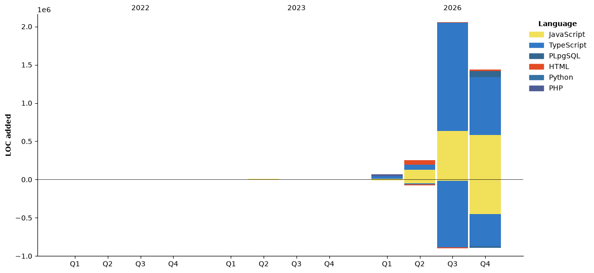

<h1 align="center">Sadik Hasan Rafi</h1>

<p align="center">
  <strong>Backend Engineer (Node.js)</strong> • PERN Stack • Angular & React
</p>

<p align="center">
  I design and build scalable backend systems, APIs, and production-ready web applications.<br/>
  Focused on performance, clean architecture, and real-world problem solving.
</p>

<p align="center">
  
</p>


## 💫 About Me

- 🛠️ Backend-focused developer working with **PERN Stack**
- 🌱 Learning **automation, backend scalability & system design**
- 👯‍♂️ Open to **collaboration, open-source & backend teams**
- 🎯 Target role: **Backend / Full-Stack Developer (Remote / International)**

---

## 💻 Tech Stack

### 🚀 Backend & Core


### 🧩 Frontend


### 🛠️ Tools & Infrastructure


---

## 📊 GitHub Activity & Stats

 <p align="center">
  
</p>

<p align="center">
  
  
</p>

<p align="center">
  
  
</p> 


---

## 📅 Contribution Overview

 <p align="center">
  
</p>

---

---

## 🔥 Contribution Streak

<!-- <p align="center">
  <a href="https://git.io/streak-stats">
    
  </a>
</p> -->


<p align="center">
<a href="https://git.io/streak-stats"></a>
</p>


## ⏱️ WakaTime Stats

<!--START_SECTION:waka-->


**🐱 My GitHub Data** 

> 📦 ? Used in GitHub's Storage 
 > 
> 🏆 1,076 Contributions in the Year 2026
 > 
> 🚫 Not Opted to Hire
 > 
> 📜 21 Public Repositories 
 > 
> 🔑 0 Private Repositories 
 > 
**I'm a Night 🦉** 

```text
🌞 Morning                206 commits         ⣿⣿⣿⣀⣀⣀⣀⣀⣀⣀⣀⣀⣀⣀⣀⣀⣀⣀⣀⣀⣀⣀⣀⣀⣀   10.24 % 
🌆 Daytime                693 commits         ⣿⣿⣿⣿⣿⣿⣿⣿⣿⣀⣀⣀⣀⣀⣀⣀⣀⣀⣀⣀⣀⣀⣀⣀⣀   34.46 % 
🌃 Evening                735 commits         ⣿⣿⣿⣿⣿⣿⣿⣿⣿⣀⣀⣀⣀⣀⣀⣀⣀⣀⣀⣀⣀⣀⣀⣀⣀   36.55 % 
🌙 Night                  377 commits         ⣿⣿⣿⣿⣿⣀⣀⣀⣀⣀⣀⣀⣀⣀⣀⣀⣀⣀⣀⣀⣀⣀⣀⣀⣀   18.75 % 
```
📅 **I'm Most Productive on Tuesday** 

```text
Monday                   252 commits         ⣿⣿⣿⣀⣀⣀⣀⣀⣀⣀⣀⣀⣀⣀⣀⣀⣀⣀⣀⣀⣀⣀⣀⣀⣀   12.53 % 
Tuesday                  506 commits         ⣿⣿⣿⣿⣿⣿⣀⣀⣀⣀⣀⣀⣀⣀⣀⣀⣀⣀⣀⣀⣀⣀⣀⣀⣀   25.16 % 
Wednesday                284 commits         ⣿⣿⣿⣿⣀⣀⣀⣀⣀⣀⣀⣀⣀⣀⣀⣀⣀⣀⣀⣀⣀⣀⣀⣀⣀   14.12 % 
Thursday                 345 commits         ⣿⣿⣿⣿⣀⣀⣀⣀⣀⣀⣀⣀⣀⣀⣀⣀⣀⣀⣀⣀⣀⣀⣀⣀⣀   17.16 % 
Friday                   85 commits          ⣿⣀⣀⣀⣀⣀⣀⣀⣀⣀⣀⣀⣀⣀⣀⣀⣀⣀⣀⣀⣀⣀⣀⣀⣀   04.23 % 
Saturday                 187 commits         ⣿⣿⣀⣀⣀⣀⣀⣀⣀⣀⣀⣀⣀⣀⣀⣀⣀⣀⣀⣀⣀⣀⣀⣀⣀   09.30 % 
Sunday                   352 commits         ⣿⣿⣿⣿⣀⣀⣀⣀⣀⣀⣀⣀⣀⣀⣀⣀⣀⣀⣀⣀⣀⣀⣀⣀⣀   17.50 % 
```


📊 **This Week I Spent My Time On** 

```text
🕑︎ Time Zone: Asia/Dhaka

💬 Programming Languages: 
TypeScript               3 hrs 5 mins        ⣿⣿⣿⣿⣿⣿⣿⣀⣀⣀⣀⣀⣀⣀⣀⣀⣀⣀⣀⣀⣀⣀⣀⣀⣀   28.27 % 
Bash                     2 hrs 25 mins       ⣿⣿⣿⣿⣿⣿⣀⣀⣀⣀⣀⣀⣀⣀⣀⣀⣀⣀⣀⣀⣀⣀⣀⣀⣀   22.22 % 
Other                    1 hr 34 mins        ⣿⣿⣿⣿⣀⣀⣀⣀⣀⣀⣀⣀⣀⣀⣀⣀⣀⣀⣀⣀⣀⣀⣀⣀⣀   14.37 % 
JSON                     1 hr 15 mins        ⣿⣿⣿⣀⣀⣀⣀⣀⣀⣀⣀⣀⣀⣀⣀⣀⣀⣀⣀⣀⣀⣀⣀⣀⣀   11.55 % 
JavaScript               49 mins             ⣿⣿⣀⣀⣀⣀⣀⣀⣀⣀⣀⣀⣀⣀⣀⣀⣀⣀⣀⣀⣀⣀⣀⣀⣀   07.50 % 

🔥 Editors: 
Claude Code              5 hrs 53 mins       ⣿⣿⣿⣿⣿⣿⣿⣿⣿⣿⣿⣿⣿⣀⣀⣀⣀⣀⣀⣀⣀⣀⣀⣀⣀   53.84 % 
VS Code                  5 hrs 1 min         ⣿⣿⣿⣿⣿⣿⣿⣿⣿⣿⣿⣀⣀⣀⣀⣀⣀⣀⣀⣀⣀⣀⣀⣀⣀   45.91 % 
Copilot CLI              1 min               ⣀⣀⣀⣀⣀⣀⣀⣀⣀⣀⣀⣀⣀⣀⣀⣀⣀⣀⣀⣀⣀⣀⣀⣀⣀   00.26 % 

💻 Operating System: 
Linux                    10 hrs 9 mins       ⣿⣿⣿⣿⣿⣿⣿⣿⣿⣿⣿⣿⣿⣿⣿⣿⣿⣿⣿⣿⣿⣿⣿⣀⣀   92.92 % 
Windows                  46 mins             ⣿⣿⣀⣀⣀⣀⣀⣀⣀⣀⣀⣀⣀⣀⣀⣀⣀⣀⣀⣀⣀⣀⣀⣀⣀   07.08 % 
```

🤖 **AI Coding This Week** 

```text
⏱ AI Coding Time: 7 hrs 10 mins (65.65%)

✍️ 22,234 lines written by AI, 2,664 lines written by hand (89.3% AI-written)

🔤 3,849,381 Input Tokens, 1,141,978 Output Tokens

💵 $57.52 Estimated AI Cost This Week

🧠 20 AI Sessions, 96 AI Prompts

Opus                     21,264 lines        ⣿⣿⣿⣿⣿⣿⣿⣿⣿⣿⣿⣿⣿⣿⣿⣿⣿⣿⣿⣿⣿⣿⣿⣿⣀   94.49 % 
Sonnet                   1,037 lines         ⣿⣀⣀⣀⣀⣀⣀⣀⣀⣀⣀⣀⣀⣀⣀⣀⣀⣀⣀⣀⣀⣀⣀⣀⣀   04.61 % 
Haiku                    204 lines           ⣀⣀⣀⣀⣀⣀⣀⣀⣀⣀⣀⣀⣀⣀⣀⣀⣀⣀⣀⣀⣀⣀⣀⣀⣀   00.91 % 
Code                     0 lines             ⣀⣀⣀⣀⣀⣀⣀⣀⣀⣀⣀⣀⣀⣀⣀⣀⣀⣀⣀⣀⣀⣀⣀⣀⣀   00.00 % 

🔎 AI Coding Insights:
🤖 AI-Driven — 89.3% of written lines came from AI
📄 Detailed Prompter — average 756 characters per prompt
🔁 Iterative Prompter — average 5 prompts per session
🔍 Hands-On Reviewer — 86.07% of changed lines were hand-edited
```

**Timeline**




 Last Updated on 25 Nov 2026 16:29 UTC UTC
<!--END_SECTION:waka-->


---

<p align="center">
✨ Open to backend & full-stack opportunities...let’s build scalable systems ✨
</p>
