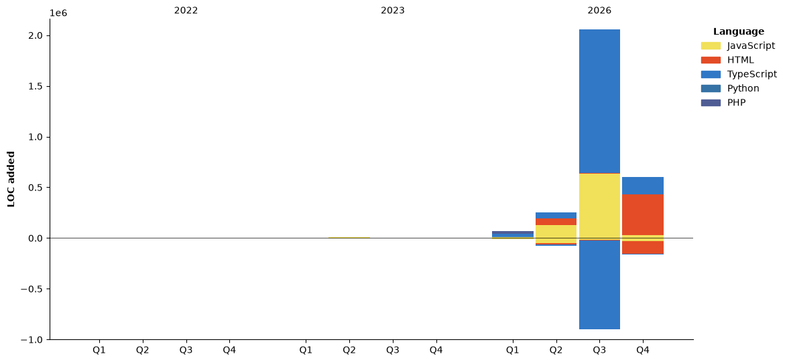

<h1 align="center">Sadik Hasan Rafi</h1>

<p align="center">
  <strong>Backend Engineer (Node.js)</strong> • PERN Stack • Angular & React
</p>

<p align="center">
  I design and build scalable backend systems, APIs, and production-ready web applications.<br/>
  Focused on performance, clean architecture, and real-world problem solving.
</p>

<p align="center">
  
</p>


## 💫 About Me

- 🛠️ Backend-focused developer working with **PERN Stack**
- 🌱 Learning **automation, backend scalability & system design**
- 👯‍♂️ Open to **collaboration, open-source & backend teams**
- 🎯 Target role: **Backend / Full-Stack Developer (Remote / International)**

---

## 💻 Tech Stack

### 🚀 Backend & Core


### 🧩 Frontend


### 🛠️ Tools & Infrastructure


---

## 📊 GitHub Activity & Stats

 <p align="center">
  
</p>

<p align="center">
  
  
</p>

<p align="center">
  
  
</p> 


---

## 📅 Contribution Overview

 <p align="center">
  
</p>

---

---

## 🔥 Contribution Streak

<!-- <p align="center">
  <a href="https://git.io/streak-stats">
    
  </a>
</p> -->


<p align="center">
<a href="https://git.io/streak-stats"></a>
</p>


## ⏱️ WakaTime Stats

<!--START_SECTION:waka-->


**🐱 My GitHub Data** 

> 📦 ? Used in GitHub's Storage 
 > 
> 🏆 996 Contributions in the Year 2026
 > 
> 🚫 Not Opted to Hire
 > 
> 📜 21 Public Repositories 
 > 
> 🔑 0 Private Repositories 
 > 
**I'm a Night 🦉** 

```text
🌞 Morning                199 commits         ⣿⣿⣿⣀⣀⣀⣀⣀⣀⣀⣀⣀⣀⣀⣀⣀⣀⣀⣀⣀⣀⣀⣀⣀⣀   11.80 % 
🌆 Daytime                618 commits         ⣿⣿⣿⣿⣿⣿⣿⣿⣿⣀⣀⣀⣀⣀⣀⣀⣀⣀⣀⣀⣀⣀⣀⣀⣀   36.65 % 
🌃 Evening                599 commits         ⣿⣿⣿⣿⣿⣿⣿⣿⣿⣀⣀⣀⣀⣀⣀⣀⣀⣀⣀⣀⣀⣀⣀⣀⣀   35.53 % 
🌙 Night                  270 commits         ⣿⣿⣿⣿⣀⣀⣀⣀⣀⣀⣀⣀⣀⣀⣀⣀⣀⣀⣀⣀⣀⣀⣀⣀⣀   16.01 % 
```
📅 **I'm Most Productive on Tuesday** 

```text
Monday                   216 commits         ⣿⣿⣿⣀⣀⣀⣀⣀⣀⣀⣀⣀⣀⣀⣀⣀⣀⣀⣀⣀⣀⣀⣀⣀⣀   12.81 % 
Tuesday                  475 commits         ⣿⣿⣿⣿⣿⣿⣿⣀⣀⣀⣀⣀⣀⣀⣀⣀⣀⣀⣀⣀⣀⣀⣀⣀⣀   28.17 % 
Wednesday                261 commits         ⣿⣿⣿⣿⣀⣀⣀⣀⣀⣀⣀⣀⣀⣀⣀⣀⣀⣀⣀⣀⣀⣀⣀⣀⣀   15.48 % 
Thursday                 273 commits         ⣿⣿⣿⣿⣀⣀⣀⣀⣀⣀⣀⣀⣀⣀⣀⣀⣀⣀⣀⣀⣀⣀⣀⣀⣀   16.19 % 
Friday                   71 commits          ⣿⣀⣀⣀⣀⣀⣀⣀⣀⣀⣀⣀⣀⣀⣀⣀⣀⣀⣀⣀⣀⣀⣀⣀⣀   04.21 % 
Saturday                 145 commits         ⣿⣿⣀⣀⣀⣀⣀⣀⣀⣀⣀⣀⣀⣀⣀⣀⣀⣀⣀⣀⣀⣀⣀⣀⣀   08.60 % 
Sunday                   245 commits         ⣿⣿⣿⣿⣀⣀⣀⣀⣀⣀⣀⣀⣀⣀⣀⣀⣀⣀⣀⣀⣀⣀⣀⣀⣀   14.53 % 
```


📊 **This Week I Spent My Time On** 

```text
🕑︎ Time Zone: Asia/Dhaka

💬 Programming Languages: 
TypeScript               12 mins             ⣿⣿⣿⣿⣿⣿⣿⣿⣀⣀⣀⣀⣀⣀⣀⣀⣀⣀⣀⣀⣀⣀⣀⣀⣀   30.64 % 
JSON                     9 mins              ⣿⣿⣿⣿⣿⣿⣀⣀⣀⣀⣀⣀⣀⣀⣀⣀⣀⣀⣀⣀⣀⣀⣀⣀⣀   24.70 % 
Other                    9 mins              ⣿⣿⣿⣿⣿⣿⣀⣀⣀⣀⣀⣀⣀⣀⣀⣀⣀⣀⣀⣀⣀⣀⣀⣀⣀   22.78 % 
Bash                     4 mins              ⣿⣿⣿⣀⣀⣀⣀⣀⣀⣀⣀⣀⣀⣀⣀⣀⣀⣀⣀⣀⣀⣀⣀⣀⣀   12.42 % 
Markdown                 3 mins              ⣿⣿⣀⣀⣀⣀⣀⣀⣀⣀⣀⣀⣀⣀⣀⣀⣀⣀⣀⣀⣀⣀⣀⣀⣀   08.34 % 

🔥 Editors: 
Claude Code              23 mins             ⣿⣿⣿⣿⣿⣿⣿⣿⣿⣿⣿⣿⣿⣿⣿⣀⣀⣀⣀⣀⣀⣀⣀⣀⣀   59.52 % 
VS Code                  9 mins              ⣿⣿⣿⣿⣿⣿⣀⣀⣀⣀⣀⣀⣀⣀⣀⣀⣀⣀⣀⣀⣀⣀⣀⣀⣀   23.17 % 
Copilot CLI              6 mins              ⣿⣿⣿⣿⣀⣀⣀⣀⣀⣀⣀⣀⣀⣀⣀⣀⣀⣀⣀⣀⣀⣀⣀⣀⣀   17.32 % 

💻 Operating System: 
Linux                    39 mins             ⣿⣿⣿⣿⣿⣿⣿⣿⣿⣿⣿⣿⣿⣿⣿⣿⣿⣿⣿⣿⣿⣿⣿⣿⣿   100.00 % 
```

🤖 **AI Coding This Week** 

```text
⏱ AI Coding Time: 33 mins (83.32%)

✍️ 523 lines written by AI, 1 lines written by hand (99.81% AI-written)

🔤 430,187 Input Tokens, 62,784 Output Tokens

💵 $3.79 Estimated AI Cost This Week

🧠 6 AI Sessions, 12 AI Prompts

Opus                     453 lines           ⣿⣿⣿⣿⣿⣿⣿⣿⣿⣿⣿⣿⣿⣿⣿⣿⣿⣿⣿⣿⣿⣿⣀⣀⣀   86.62 % 
GPT                      48 lines            ⣿⣿⣀⣀⣀⣀⣀⣀⣀⣀⣀⣀⣀⣀⣀⣀⣀⣀⣀⣀⣀⣀⣀⣀⣀   09.18 % 
Sonnet                   22 lines            ⣿⣀⣀⣀⣀⣀⣀⣀⣀⣀⣀⣀⣀⣀⣀⣀⣀⣀⣀⣀⣀⣀⣀⣀⣀   04.21 % 

🔎 AI Coding Insights:
🤖 AI-Driven — 99.81% of written lines came from AI
📄 Detailed Prompter — average 705 characters per prompt
🔁 Iterative Prompter — average 2 prompts per session
🚀 High AI Trust — 0.38% of changed lines were hand-edited
```

**Timeline**




 Last Updated on 03 Nov 2026 14:14 UTC UTC
<!--END_SECTION:waka-->


---

<p align="center">
✨ Open to backend & full-stack opportunities...let’s build scalable systems ✨
</p>
